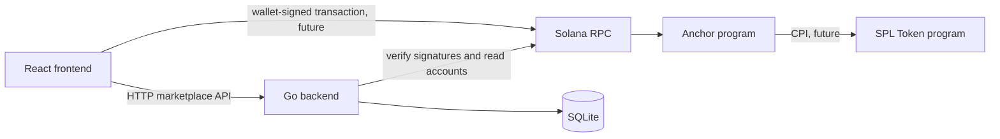

# Pact architecture

## Ownership boundaries

The React frontend is the user interface. It talks to the Go API over HTTP for users, listings, orders, and conversations. For a future escrow transaction, it may also build a transaction and ask the user's browser wallet to sign and submit it.

The Go backend owns conventional marketplace data in SQLite: profiles, listing details and inventory, orders, conversations, messages, and a local record of payments and transaction history. The backend is the source of application workflow state. It must verify submitted signatures and query the configured Solana RPC/program state before recording a payment as secured; a frontend success message alone is never proof of payment.

The Anchor program owns only the minimum financial state: marketplace configuration, one escrow state account per order, and the token vault required to hold escrow funds. It does not store product data, profiles, messages, or inventory. SPL Token (or a deliberately chosen Token-2022 deployment in a future design) performs token movement through CPI. This scaffold uses the classic SPL Token program model.

SQLite is the selected database. PostgreSQL is not part of this architecture.

## Three distinct states

An order's marketplace status describes the business workflow (for example `pending_payment`, `paid`, `fulfilling`, `completed`, or `cancelled`). An escrow status describes program state (for example `created`, `funded`, `released`, `refunded`, or `disputed`). Transaction submission status describes a particular RPC transaction (`submitted`, `confirmed`, `finalized`, or `failed`).

These states are related but not interchangeable. A transaction signature can be submitted yet fail; an order can be awaiting payment while its escrow PDA is initialized; and an on-chain escrow can be funded while the seller has not fulfilled the order. The backend should reconcile observed finalized chain state into a domain transition with an auditable transaction-history entry.

## Trust and integration boundary

Wallet signing stays in the frontend. The backend never receives or stores user private keys. The blockchain package in Go defines the integration boundary for PDA validation, RPC reads, signature verification, and future monitoring/reconciliation. It intentionally does not shell out to Rust or pretend to verify chain outcomes before an RPC client is implemented.

The order ID should be a stable, canonical value shared between database and chain. The program currently models it as 32 bytes so it can be used directly as a PDA seed. Define the encoding before production; do not derive PDAs from ambiguous display strings.
