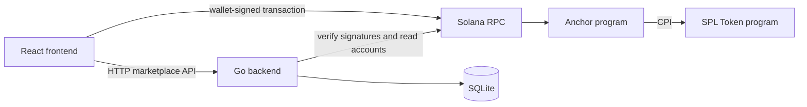

# Solstice architecture

## Ownership boundaries

The React frontend is the user interface. It talks to the Go API over HTTP for users, listings, orders, and conversations. For eligible orders it constructs an Anchor transaction with Solana Kit, simulates it, and asks the browser wallet to sign and submit it.

The Go backend owns conventional marketplace data in SQLite: profiles, listing details and inventory, orders, conversations, messages, and a local record of payments and transaction history. Wallet signatures authenticate users; server-side opaque sessions authorize API actions. The backend is the source of application workflow state. It verifies submitted signatures against finalized Solana RPC transactions and escrow/vault state before recording a payment as secured; a frontend success message alone is never proof of payment.

The Anchor program owns only the minimum financial state: marketplace configuration, one escrow state account per order, and the associated token account vault required to hold escrow funds. It does not store product data, profiles, messages, or inventory. The classic SPL Token program performs token movement through CPI.

SQLite is the selected database. PostgreSQL is not part of this architecture.

## Three distinct states

An order's marketplace status describes the business workflow (for example `pending_payment`, `paid`, `fulfilling`, `completed`, or `cancelled`). An escrow status describes program state (for example `created`, `funded`, `released`, `refunded`, or `disputed`). Transaction submission status describes a particular RPC transaction (`submitted`, `confirmed`, `finalized`, or `failed`).

These states are related but not interchangeable. A transaction signature can be submitted yet fail; an order can be awaiting payment while its escrow PDA is initialized; and an on-chain escrow can be funded while the seller has not fulfilled the order. The backend stores transaction submissions separately and a retry worker reconciles finalized chain state into order/payment transitions with an auditable transaction-history entry.

## Trust and integration boundary

Wallet signing stays in the frontend. The backend never receives or stores user private keys. The Go blockchain package derives the escrow PDA, reads version-aware finalized transactions, validates the expected Anchor instruction/account set, verifies escrow account ownership/layout and classic SPL token vault state, and retries pending signature checks. It does not shell out to Rust. The normal trade path implements create, fund, release, and timeout-refund instructions; administrator refund and dispute resolution remain explicit `NotImplemented` extension points.

Each order stores a cryptographically random, unique 32-byte `chain_order_id`, returned as hex and used directly with the program's `escrow` seed. The payment record includes a 30-minute funding deadline passed to escrow creation. Once funded, the program starts a separate seven-day fulfillment/refund window. Unfunded cancellation waits for the funding deadline and a finality grace period, then checks finalized escrow state before restoring inventory. Do not enable real-value use until the program is deployed, its account/instruction layouts are synchronized with the app, and the custody path has been audited.
